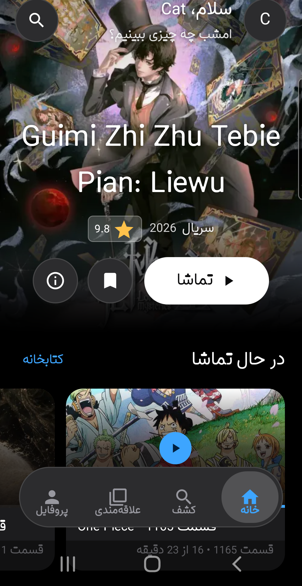
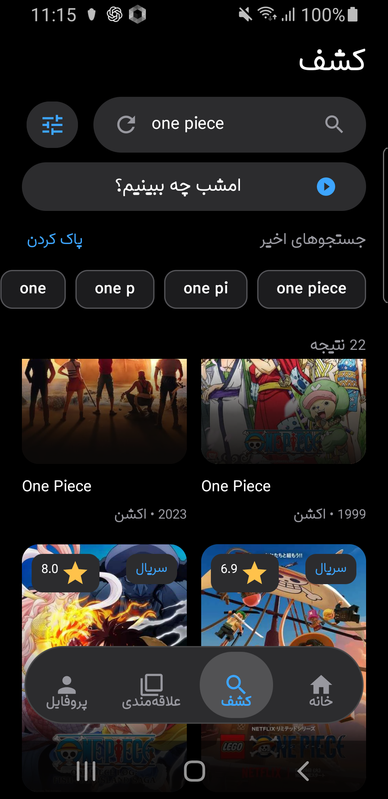
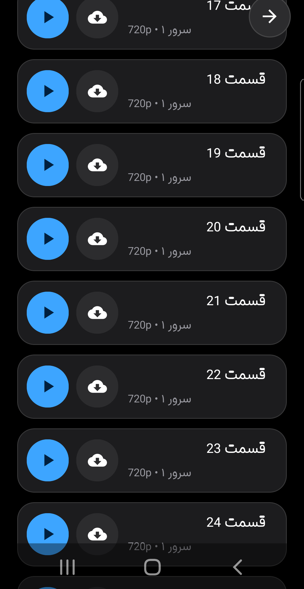
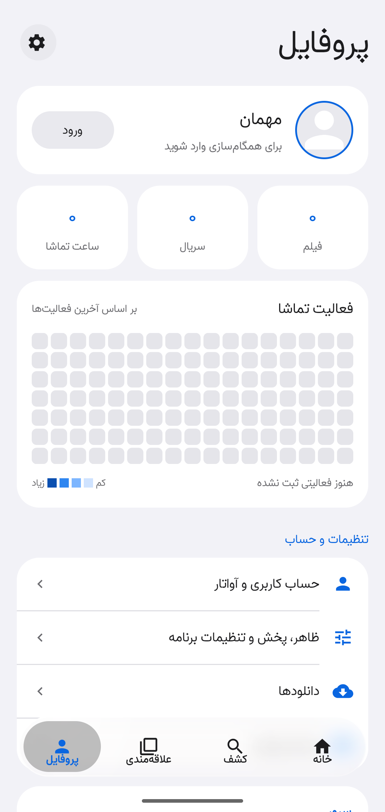
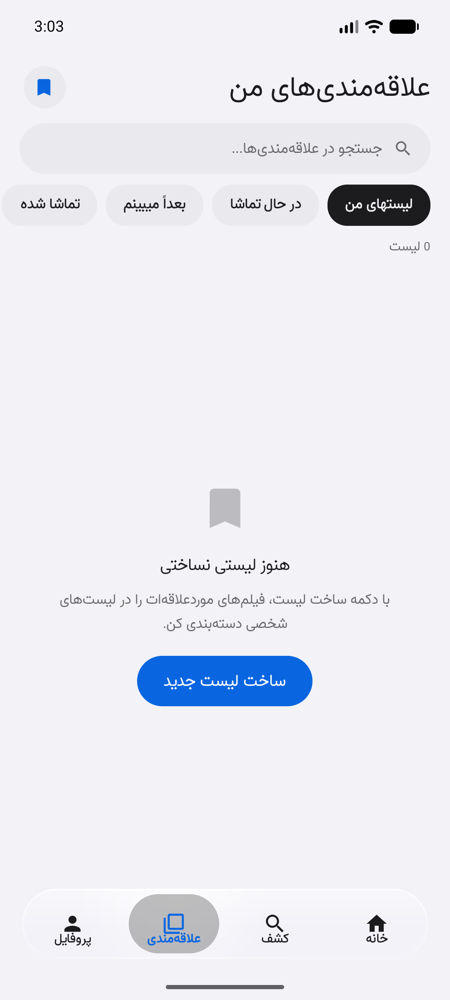
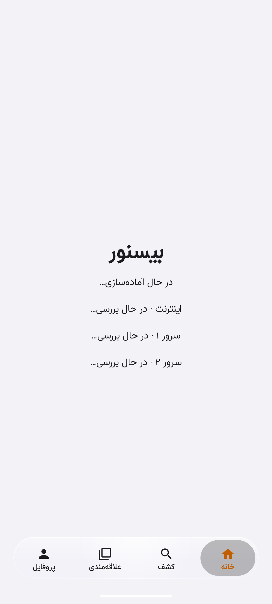
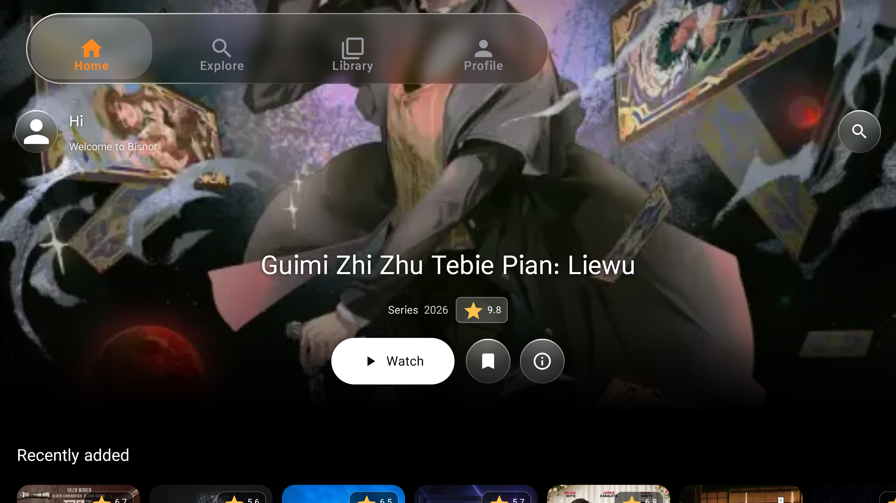

<div align="center">


# Bisnor 💎

### تماشا بدون مرز

کلاینت متن‌باز برای مرور، جست‌وجو و پخش فیلم و سریال؛ با ظاهر شیشه‌ای (Liquid Glass)، فونت فارسی **اجر**، و نسخه‌های اندروید، تلویزیون، ویندوز و وب.

[](https://github.com/nikan48g/Bisnor/releases/latest)
[](LICENSE)
[](app/build.gradle.kts)

</div>

---

## 📸 نمای برنامه

<p align="center">
  
  
  
</p>

<p align="center">
  
  
  
  
</p>

---

## ✨ امکانات

- **دو منبع پخش:** نکست‌مووی و ایران‌فلیکس؛ حالت خودکار سالم‌ترین سرور را انتخاب می‌کند یا می‌توانی دستی انتخاب کنی.
- **جست‌وجوی پیشرفته:** بر اساس عنوان، ژانر، کشور، سال و امتیاز IMDb.
- **علاقه‌مندی‌ها و لیست‌ها:** لیست شخصی بساز، مرتب کن و با لینک کوتاه با دوستانت به اشتراک بگذار.
- **همگام‌سازی حساب:** با حساب کاربری، لیست‌ها و پیشرفت تماشا روی همه‌ی دستگاه‌هایت می‌آید.
- **دانلود ۸ تکه‌ای:** هر فایل با ۸ اتصال هم‌زمان دانلود می‌شود؛ پیشرفت هر تکه جداگانه دیده می‌شود و می‌توانی پوشه ذخیره را انتخاب کنی.
- **پخش‌کننده:** ادامه‌ی خودکار قسمت بعد، زیرنویس فارسی، انتخاب کیفیت و سرعت، و امکان باز کردن با VLC یا MX Player.
- **دو ظاهر و دو حالت:** ظاهر شیشه‌ای یا کلاسیک (سبک برای گوشی‌های ضعیف)، روشن یا تاریک.
- **فارسی و انگلیسی:** فونت فارسی **اجر** یا **اجر فانتزی** و در حالت انگلیسی فونت سینمایی Bebas Neue.
- **رایگان و متن‌باز:** بدون اشتراک، بدون تبلیغ.

---

## 📦 دانلود و نصب

| پلتفرم | وضعیت |
| --- | --- |
| اندروید (گوشی و تبلت) | پایدار؛ فایل APK در [Releases](https://github.com/nikan48g/Bisnor/releases/latest) |
| اندروید TV | پایدار؛ همان APK با ناوبری ریموت |
| ویندوز | آزمایشی؛ نصب‌کننده در [Releases](https://github.com/nikan48g/Bisnor/releases/latest) |
| Samsung Tizen TV | آزمایشی |
| وب (هر مرورگری، از جمله آیفون) | آزمایشی: <https://bisnor-pwa.drive-storage-hnn.workers.dev> |

> اگر اندروید یا ویندوز داری، نسخه‌ی اصلی را ترجیح بده؛ نسخه‌ی وب ممکن است در پخش یا ورود ایراد داشته باشد.

---

## 🛠 ساخت از سورس

نیازمندها: Android Studio (JDK 17) و Android SDK 35.

```powershell
git clone https://github.com/nikan48g/Bisnor.git
cd Bisnor
./gradlew assembleDebug
```

APK در `app/build/outputs/apk/debug/` ساخته می‌شود. جزئیات بیشتر در [docs/BUILD.md](docs/BUILD.md) است.

---

## 🧩 ساختار پروژه

| بخش | مسیر |
| --- | --- |
| اندروید | `app/` |
| ویندوز (WebView2) | `desktop/BisnorDesktop/` |
| وب (PWA) | `desktop/BisnorDesktop/wwwroot/` |
| Samsung Tizen TV | `tizen-tv/` |
| Worker (لینک کوتاه، پروکسی) | `cloudflare/worker/` |
| دیتابیس | `supabase/` |

---

## 💎 منابع محتوا

بیسنور برای فهرست و لینک‌های پخش از **IranFlix** و **نکست‌مووی** استفاده می‌کند. این سرویس‌ها، APIها و محتوای رسانه‌ای متعلق به صاحبان آن‌ها هستند و تحت مجوز MIT این مخزن نیستند.

بیسنور فیلم یا سریالی را میزبانی نمی‌کند؛ فقط یک کلاینت است.

---

## 🤝 مشارکت و گزارش مشکل

- ایده یا اصلاح داری؟ Pull Request بفرست.
- مشکلی پیدا کردی؟ [Issue جدید بساز](https://github.com/nikan48g/Bisnor/issues) و این موارد را بنویس: سیستم‌عامل و نسخه‌ی برنامه، مراحل تکرار، و پیام خطا (اگر بود).

---

## 📄 مجوز

[MIT](LICENSE)

اگر بیسنور به کارت آمد، یک ⭐ بده. ❤️

<div align="center">Made by HNN</div>
